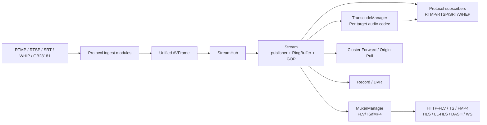
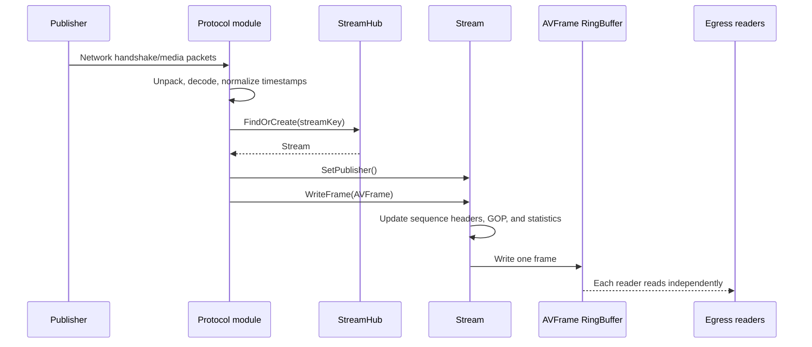
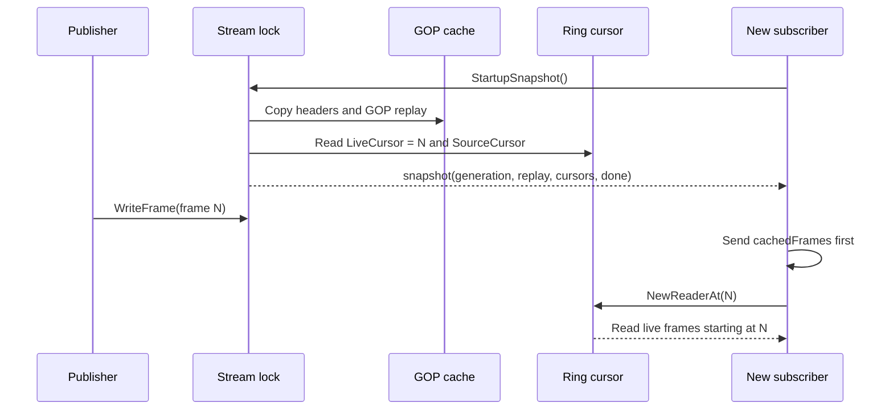
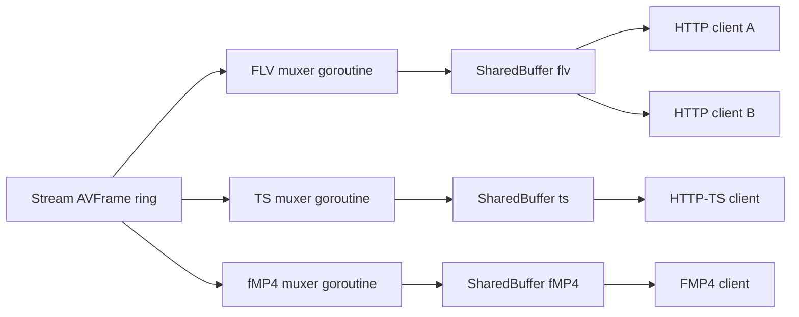
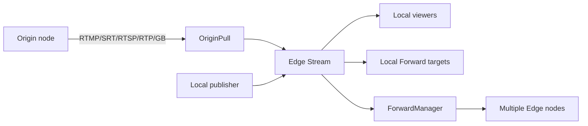

# LiveForge Service Architecture Analysis

This document describes LiveForge's process structure, module boundaries, media data flow, forwarding, GOP cache, RingBuffer, transcoding, and lifecycle management based on the repository's current source code, rather than designs in `docs/superpowers/specs/` that may not yet be implemented. Treat it as a supplement for navigating the source and assessing capacity, rather than a new interface specification.

## 1. Service Overview

LiveForge is a single-process, modular live streaming server written in Go. Input from different protocols is first decoded into a unified `AVFrame` and written to the same `Stream`; outputs read that stream according to their protocol, then encapsulate it or transcode it as needed. Protocol interoperability therefore depends on all modules sharing `core.StreamHub` and `core.Stream`, rather than on writing an adapter for every pair of protocols.



### Design Principles

- **Unified clock and frame model**: `DTS` and `PTS` use milliseconds; payloads retain the original codec data without container headers.
- **Single publisher, multiple readers**: Each stream key accepts only one publisher at a time; every consumer has its own cursor, so another consumer's reads do not consume its data.
- **Continuity between cached and live media**: New subscribers first receive history beginning at a keyframe from the current publisher generation, then continue with live data from the same snapshot's cursor. Replacing a publisher terminates the old generation; an old ring buffer must not be joined to a new publisher. If outbound SIP/GB28181 signaling encounters generation termination after a 2xx response, it sends one BYE through the accepted dialog before releasing transaction and session resources.
- **Isolated protocol state**: Frames or already-muxed bytes are shared; connection state such as SSRC, RTP sequence numbers, and RTMP chunk state still belongs to each connection.
- **Resources on demand**: Muxers, audio transcoding tracks, origin pulls, and forward targets are created when actually needed and reclaimed when no consumers remain or on shutdown.

## 2. Process Startup and Module Dependencies

The entry point is [`cmd/liveforge/main.go`](../cmd/liveforge/main.go). Startup proceeds as follows:

1. Read the bootstrap configuration and create `core.Server`, the runtime configuration manager, `StreamHub`, and `EventBus`.
2. Register modules in dependency order: `auth`, `rtmp`, `rtsp`, `httpstream`, `srt`, `webrtc`, `sip`, `gb28181`, `sipgateway`, `notify`, `cluster`, `api`, `record`, `dvr`, and `metrics`.
3. `Server.Init()` calls each module's `Init()` in registration order, collects listeners and event hooks, and finally starts the alive loop.
4. If initialization fails, close only the modules whose initialization was attempted, in reverse order. Preserve the original error and do not inadvertently close modules whose initialization was never attempted.
5. Normal shutdown also calls `Close()` in reverse order, waking RingBuffers and waiting readers.

Modules participate in the lifecycle through the `Module`, `Reloadable`, `ReloadPreparer`, `ConfigApplied`, and `EndpointProvider` interfaces in [`core/module.go`](../core/module.go). The authentication module must be registered first because it installs synchronous hooks for subsequent protocols' publish/subscribe events.

## 3. Module Layers and Responsibilities

| Layer | Main directories | Responsibilities | Shared objects |
| --- | --- | --- | --- |
| Process orchestration | `cmd/liveforge`, `core/server.go` | Startup, shutdown, configuration application, module ordering | `Server` |
| Core stream hub | `core/stream_hub.go`, `core/stream.go` | Stream lookup/creation, publishers, subscribers, caching, and statistics | `StreamHub`, `Stream` |
| Media primitives | `pkg/avframe`, `pkg/rtp`, `pkg/muxer`, `pkg/util` | Frames, RTP, FLV/TS/fMP4, RingBuffer | `AVFrame`, `RingReader` |
| Ingest/playback | `module/rtmp`, `rtsp`, `srt`, `webrtc`, `gb28181` | Network handshakes, protocol parsing, frame encapsulation and decapsulation | `Stream` |
| HTTP delivery | `module/httpstream` | Shared muxers, HLS/LL-HLS/DASH, HTTP-FLV/TS/FMP4/WS | `MuxerManager`, `SharedBuffer` |
| Cross-node communication | `module/cluster` | Forwarding, origin pulls, transport registration, scheduling, and health checks | `RelayTransport`, `RingReader` |
| Media processing | `core/transcode_manager.go` | Shared transcoding tracks for each target audio codec | `TranscodedTrack` |
| Persistence | `module/record`, `module/dvr` | File recording, keyframe segmentation, time-shift indexes | Independent readers |
| Control plane | `module/api`, `auth`, `notify`, `metrics` | REST/console, authentication, notifications, Prometheus | `EventBus` |
| GB28181/SIP | `module/sip`, `module/gb28181`, `module/sipgateway` | SIP signaling, device lifecycles, RTP/PS media | SIP service, `Stream` |

Modules communicate through core interfaces and events wherever possible. Protocol modules do not call other protocol modules directly, avoiding pairwise dependencies such as RTMP-to-WebRTC or RTSP-to-HLS.

## 4. Core Object Model

### 4.1 StreamHub

[`core/stream_hub.go`](../core/stream_hub.go) maintains `map[string]*Stream`; the stream key is the common aggregation key across all protocols. It is responsible for:

- Looking up, creating, and deleting `Stream` instances;
- Enforcing the `max_streams` limit;
- Creating the main RingBuffer, MuxerManager, and FeedbackRouter for new streams;
- Attaching a `TranscodeManager` when `audiocodec` is enabled;
- Coordinating destruction after idle/no-publisher timeouts.

### 4.2 Stream

A `Stream` represents one logical stream and one publisher. Its states include:

| State | Meaning |
| --- | --- |
| `idle` | Not yet published; may be waiting for a subscription to trigger an origin pull |
| `waiting_pull` | Waiting for an origin pull in cluster semantics |
| `publishing` | Bound to a publisher and continuously receiving frames |
| `no_publisher` | The publisher has disconnected, but subscribers and caches may remain |
| `destroying` | Cleanup has begun |

A Stream holds:

- The main `RingBuffer[*avframe.AVFrame]`;
- A number of recent GOPs containing interleaved audio and video frames; audio-only streams do not maintain a separate startup cache;
- Video/audio sequence headers;
- `MuxerManager`, `FeedbackRouter`, and `TranscodeManager`;
- Subscriber counts by protocol and traffic statistics;
- The publisher, lifecycle state, and idle/no-publisher timers.

`SetPublisher()` rejects duplicate publishers; republishing cancels old timers and resets transcoding tracks. A publisher disconnect transitions the stream to `no_publisher`, with cleanup controlled by `no_publisher_timeout`; when there is neither a publisher nor a subscriber, cleanup is controlled by `idle_timeout`.

### 4.3 AVFrame

[`pkg/avframe/frame.go`](../pkg/avframe/frame.go) defines the unified media frame:

```text
MediaType: Video / Audio
Codec: H264/H265/AV1/VP8/VP9, AAC/Opus/MP3/G711/G722/G729/Speex...
FrameType: Keyframe / Interframe / SequenceHeader
DTS, PTS: Millisecond timestamps
Payload: Original codec payload without container or transport encapsulation such as FLV, TS, or RTP
```

Ingest modules normalize network timestamps into this model; output modules convert them back to the units and encapsulation required by each protocol.

### 4.4 Startup Readiness

Startup readiness is calculated for the current publisher generation and reset when the publisher changes:

- H.264, H.265, and AAC require their corresponding sequence headers first, preventing incomplete parameters from creating unplayable containers or decoders;
- AV1, VP8, VP9, Opus, MP3, G.711, G.722, and G.729 carry the required parameters in media frames or SDP/protocol negotiation, so they do not wait for a separate sequence header that does not exist;
- Every currently identified track must satisfy its own rules; a stream with no audio or video tracks is not ready;
- Audio-only streams have no video keyframes. Subscribers receive data from the current live cursor without replaying a separate audio cache.

## 5. Publishing Data Flow

Whether input comes from RTMP, RTSP, SRT, WHIP, or GB28181, the path can be represented as:



`Stream.WriteFrame()` completes cache and ring writes under the stream mutex, ensuring a consistent relationship between GOP snapshots and ring cursors. When `max_bitrate_per_stream` is exceeded, sequence headers can still be written, but ordinary frames are rejected.

### 5.1 Conversion for Each Input Protocol

- **RTMP publish**: After handshake, chunk, and AMF0 parsing, convert FLV video/audio messages to `AVFrame`; synchronize sequence headers to the publisher's `MediaInfo`.
- **RTSP publish**: ANNOUNCE SDP establishes codec/PT mappings; the RTP depacketizer aggregates access units according to the marker, then normalizes RTP timestamps to milliseconds.
- **SRT publish**: Determine the operation from the SRT stream ID, parse MPEG-TS, and extract audio/video frames.
- **WHIP publish**: Receive RTP after SDP offer negotiation; align audio and video using a session-level RTP clock and packet-arrival offset to avoid a fixed time offset between the two tracks.
- **GB28181**: SIP INVITE/SDP establishes the session, which receives PS over RTP; after complete PS packs are aggregated, the MPEG-PS demuxer produces AVFrames.

## 6. Stream Writes, Sequence Headers, and Cache Path

Each `WriteFrame()` follows this order:

1. Check the per-stream bitrate limit; reject frames other than sequence headers when the limit is exceeded.
2. On a sequence header, update video SPS/PPS (or VPS/SPS/PPS) and audio AudioSpecificConfig, then close `seqHeaderReady` to wake subscribers waiting for initialization.
3. Start a new GOP on a video keyframe; append video interframes to the current GOP; append audio frames to the current GOP to preserve A/V DTS order.
4. Update statistics such as frame count, byte count, bitrate, and frame rate.
5. Write the same `AVFrame` pointer to the main RingBuffer.

The core does not repeatedly copy frame payloads; copying occurs only for muxed bytes that need isolated lifetimes, such as SharedBuffer data, or for snapshot slices. Consumers must not modify shared `AVFrame` contents.

## 7. GOP Cache Design

### 7.1 Cache Contents

The GOP cache contains the most recent `GOPCacheNum` video GOPs. Each GOP begins with a video keyframe, includes subsequent video frames, and interleaves audio frames within its time range; it is therefore not an array that caches only video frames. Sequence headers are stored separately and are not counted in the GOP frame list. `GOPCacheDetail()` reports total frames, audio/video frame counts, and DTS duration.

Audio-only streams have no video keyframes, so they do not produce GOP startup history; late subscribers receive subsequent frames from an atomically captured live cursor. The core does not maintain a separate startup cache for audio-only streams.

When a video keyframe arrives, the code first records the current ring write cursor as `gopStart`, then appends the new GOP; excess GOPs are trimmed from the oldest end. `GOPCacheSourceStart()` returns the ring position corresponding to the oldest GOP, for transcoding workers that need to read from a historical starting point.

### 7.2 Atomic Snapshots

`StartupSnapshot()` copies the complete startup state of the current publisher generation under the same Stream read lock: `MediaInfo`, audio/video sequence headers, GOP replay frames, `LiveCursor`, `SourceCursor`, the generation number, and `GenerationDone`. `LiveCursor` points to the first frame after the snapshot; `SourceCursor` points to the ring position of the oldest cached GOP and is used only by workers that need to transform historical input. Compatibility callers can still use `GOPCacheSnapshot()`, but protocol subscriptions and shared HTTP muxers use the complete startup snapshot.



If media info, headers, cache, and cursor are read separately, the publisher may write a frame or be replaced between calls: a subscriber may duplicate or miss boundary frames, or combine initialization state from an old generation with media from a new one. Atomic snapshots eliminate these windows. Subscription readers also monitor `GenerationDone`; after a blocked read wakes and before processing a frame, they call `IsPublisherGeneration`, so the replacement generation's first frame cannot leak to old subscribers.

SIP Gateway outbound calls and GB28181 outbound media carry the same snapshot through SDP/codec selection, the INVITE wait, ACK, subscriber admission, and the media reader. If the generation ends before ACK or activation, the old session does not continue establishment and does not pair old signaling with new media. If the generation terminates after a 2xx acceptance, SIP/GB28181 sends one BYE through an idempotent accepted-dialog cleanup path; cancellation before 2xx still only closes the unestablished transaction. If GB28181 PS forwarding fails to send the video sequence header, it returns an error identifying the stage and stops before replay/live media.

### 7.3 Starting Points for Different Consumers

- Ordinary RTMP, RTSP, SRT, shared HTTP FLV/TS/fMP4 muxers, and WHEP: Direct media readers read from `LiveCursor`. Live mode first sends `ReplayFrames`; WHEP realtime sends no replay and waits for the reader's first keyframe.
- When RTMP, WHEP, or shared HTTP muxers need to transform historical audio, they create a separate audio-only reader and use `SourceCursor` only as the starting point for transcoding input. Direct video still comes from the `LiveCursor` reader, so historical transcoding output does not duplicate replay video or startup headers. The startup snapshot also privately carries the current audio codec epoch floor. Snapshot-bound readers retain historical video needed by combined paths but discard audio below that floor, so late joiners do not first output audio from an old epoch or move DTS backward. Each change in source audio codec within the same publisher generation starts a new codec epoch; publisher frames carry source provenance, and headers/media generated by transcoding carry transformed provenance. Shared HTTP FLV/TS/fMP4 acquires a shared target-AAC track even when playback starts with direct AAC: source-provenance copies are left for the direct reader alone to send, while later G.711/Opus epochs can immediately resume transcoding without losing the first frame or affecting direct video. Each shared HTTP muxer has only one audio owner at a time for each epoch: G.711/Opus epochs use transcoded AAC, a real source AAC epoch switches atomically to the direct reader, and a return to G.711/Opus switches back to the transcoding reader. The transcoder's own startup AAC header only represents the target track already declared by init data and must not be treated as a source handoff; old-epoch frames that raced into a queue are discarded. Each worker retains its own transcoding reader for its entire lifetime. Switching the owner does not release the shared producer, so FLV/TS/fMP4 workers do not close one another, and RTMP/WHEP target-audio readers and HLS, LL-HLS, and DASH combined readers also remain open. Every new epoch requiring transcoding rebuilds the decoder, encoder, resampler, timestamp tracker, and PCM buffer. Source frames already using the target codec pass through directly; an unsupported epoch only leaves the pipeline unavailable, without closing or removing the producer. A later supported epoch sends the current target header/media to existing and new readers. The direct video reader remains unaffected by audio switching throughout.
- Compatibility paths for HLS, LL-HLS, and DASH still use combined historical transcoding readers and filter potentially duplicate video frames using the cached video DTS range; these segmenters have not yet migrated to independent direct/audio readers.
- SRT no longer uses the maximum DTS across audio and video to filter replay/live overlap; the cursor is the sole duplication boundary, so live audio at DTS 1000 is still sent after cached video at DTS 4000.

## 8. RingBuffer Design and Concurrency Semantics

### 8.1 Basic Model

[`pkg/util/ringbuffer.go`](../pkg/util/ringbuffer.go) is a generic SPMC (single producer / multiple consumer) ring buffer:

```text
buf:         Fixed-capacity []T
writeCursor: Monotonically increasing logical write position
RingReader:  Independent readCursor for each consumer
```

`NewReader()` starts at the oldest position still retained; `NewReaderAt(pos)` starts at the specified logical position. Once capacity is reached, the oldest elements are silently overwritten. RingBuffer does not provide unbounded queuing or persistence.

### 8.2 Writes and Reads

The writer first writes the slot under `dataMu.Lock()`, then advances the atomic cursor. A reader retrieves the slot under `dataMu.RLock()` and rechecks inside the lock whether the writer has caught up and overwritten that position. This short critical section keeps the cursor consistent with slot contents, but the implementation is **not fully lock-free**.

There are two waiting mechanisms:

- Prefer `RingReader.ReadContext(ctx)` and `WaitContext(ctx)`. They use each reader's own state with `sync.Cond`; context cancellation, reader closure, and ring closure all wake the reader, and readers cannot steal one another's wakeup signals.
- `Signal()` is a legacy shared channel; multiple readers may consume the same notification. It is suitable only for older paths that need to combine ring notifications with other channels in a select. Cluster relay, WHEP feeds, and transcoding workers use reader-scoped waits and do not rely on shared Signal.

`Read()` blocks while waiting rather than busy-spinning; `Close()` wakes all waiters. Closing a single `RingReader` does not affect other consumers.

### 8.3 Overwrites, Dropped Frames, and Lag

When `readCursor < writeCursor - capacity`, a reader has fallen behind far enough for its position to be overwritten. `TryRead()` jumps to the oldest available position and reports the number of frames skipped by that jump through `Skipped()`. `Lag()` normalizes lag to `[0, 1]`, where 1 means close to being overwritten.

This makes RingBuffer a live distribution buffer rather than a reliable queue: slow consumers eventually lose frames, and the application layer must decide whether to drop frames, advance to a keyframe, or disconnect.

## 9. SharedBuffer and MuxerManager

### 9.1 Why a Second Buffer Layer Is Needed

The main ring stores `AVFrame` instances. HTTP-FLV, HTTP-TS, and FMP4 require continuous container state, such as FLV headers, PAT/PMT, fMP4 init, and fragment sequences. Muxing separately for each HTTP client would duplicate CPU work and state management, so the HTTP module shares one muxer per format.

`core.SharedBuffer` wraps `RingBuffer[[]byte]`; each write contains already-muxed bytes, and every client receives an independent `SharedBufferReader`.

### 9.2 MuxerManager Lifecycle

For each stream, `MuxerManager` stores `MuxerInstance` objects by `flv`, `ts`, and `mp4`:

1. When the first subscriber for a format arrives, create a SharedBuffer, a `Done` channel, and a generation-bound `MuxerInstance` for the current publisher generation, then start a muxer goroutine.
2. The muxer first captures a startup snapshot with the same generation as the instance. While not yet ready, it also waits on that snapshot's `GenerationDone` and exits immediately if the publisher is removed; it must not wait for and attach to a replacement generation. Once ready, it writes init/header data and replay to SharedBuffer, then continues direct media from `LiveCursor`; the shared target-AAC reader takes input from `SourceCursor` and filters old audio using the snapshot's epoch floor. FLV/TS/fMP4 workers switch in both directions between transcoded AAC and direct AAC owners according to source codec epoch and provenance. Even if playback starts with direct AAC, the worker retains its shared target subscription to observe later G.711/Opus. Generated startup headers do not trigger a handoff; only real source AAC is sent exclusively by the direct owner. A return to G.711/Opus resumes audio through a new transcoding epoch. TS always declares this AAC output track as AAC in PAT/PMT.
3. Later subscribers to the same format read through shared bytes readers without creating another muxer.
4. HTTP/WS requests release the actual instance they acquired. When the last subscriber releases it or that publisher generation ends, `Done` closes, the muxer closes its reader and SharedBuffer, and the instance is removed from the manager. Old requests cannot decrement the replacement generation's instance.



RTMP, RTSP, and SRT usually read the AVFrame ring directly because each connection has independent RTMP chunk/FLV state, RTP packetizer/SSRC/sequence/timestamp state, or TS output state. The current implementation does not have the explicit packet reference counting found in the old design; sharing occurs at frame pointers in the ring or byte slices in SharedBuffer.

## 10. Playback and Output Paths

### RTMP

After authentication, RTMP play finds or creates the stream, adds a subscriber, then:

1. Waits for sequence headers;
2. Sends FLV sequence headers;
3. Sends the GOP snapshot;
4. Reads live AVFrames from `LiveCursor`, confirming after each wakeup that the publisher generation still matches;
5. Uses a connection-private FLV muxer to encode RTMP chunks;
6. Uses `SlowConsumerFilter` to drop non-key video frames according to lag.

When the audio codec is incompatible, direct video still comes from the main ring's `LiveCursor` reader, while a separate audio-only TranscodeManager reader obtains conversion input from `SourceCursor`; compatible media is read directly from the main ring. Replay video, video sequence headers, and target audio headers are each sent only once, while subsequent live sequence headers emitted by the publisher are still forwarded to the RTMP peer.

### RTSP

RTSP supports OPTIONS, DESCRIBE, SETUP, and PLAY, as well as ANNOUNCE, RECORD, and TEARDOWN; supported transports are TCP interleaved, UDP unicast, and UDP multicast. DESCRIBE generates SDP from a ready `StartupSnapshot` and saves that same snapshot under the session mutex. PLAY may use only that generation's media/headers/replay/cursor; if the publisher is removed or replaced after DESCRIBE, playback is rejected rather than pairing old SDP with new media. Each subscriber independently creates packetizer, SSRC, sequence, and RTP timestamp state. RTP packets cannot simply be shared between connections even when all underlying data comes from the same RingBuffer.

### SRT

The SRT stream ID determines publish or subscribe. The subscriber creates a TS muxer from one startup snapshot, sends replay first, then continues from `LiveCursor`; it does not use a maximum DTS watermark across tracks. Live sequence headers update known codecs/headers and rebuild the TS muxer, immediately sending new PAT/PMT before that track's first frame. Thus, even if no video keyframe follows a late AAC header, the first audio frame is neither sent under a video-only PMT nor discarded. To withstand GOP bursts, a write queue returning `io.EOF` is retried briefly. SRT subscriptions also use slow-consumer filtering and exit when the generation ends.

### HTTP-FLV, HTTP-TS, and FMP4

These paths reuse the format muxers described in the previous section:

- FLV: Headers and sequence headers form the init data, followed by shared FLV tags;
- TS: PAT/PMT can be written inline before keyframes; when a late sequence header adds or changes a track, the shared muxer first emits refreshed PAT/PMT separately, then emits that track's first frame without duplication;
- FMP4: The init segment is emitted separately, the GOP becomes the first fragment, and live frames are aggregated roughly every 200 ms. DTS/PTS are rebased when the timeline is established, while B-frames' signed composition offsets are preserved.

### HLS, LL-HLS, and DASH

HLS/LL-HLS/DASH consume muxer output in the HTTP module. When video is present, segments are still cut only at keyframe boundaries. For audio-only media, the current segment is completed according to the configured media duration before the boundary frame is written; that frame enters only the next segment, exactly once, without waiting for the source to end:

- HLS retains a sliding window;
- LL-HLS outputs parts and supports blocking playlist reload, `_HLS_msn`, and `_HLS_part`; `part_duration` controls parts, while `segment_duration` controls full segments, defaults to 1.0 second, and supports hot updates. Cold startup first waits for a complete segment, with a wait budget of `segment_duration + part_duration` rounded up to milliseconds and bounded between 10 and 30 seconds. A timeout or manager termination returns 503, avoiding repeated player appends caused by advertising only parts;
- DASH separates audio/video init data and segments and uses an exact `SegmentTimeline`. An audio-only MPD does not advertise a fictitious video adaptation and can be returned once the first complete segment is produced. Whether source DTS begins at zero or a nonzero value, all fMP4 fragments retain one continuous relative decode timeline.

### WebRTC WHEP

WHEP creates a PeerConnection and matches video/audio tracks using the offer's m-lines and codecs. `TrackSender` independently handles RTCP, PLI/FIR, NACK, and statistics; the feed loop waits until ICE/DTLS is ready before sending media.

- `realtime` mode skips the GOP and waits for the next live keyframe;
- `live` mode sends the GOP, then continues from the ring;
- H.264/H.265 convert AVCC/HVCC to Annex-B and insert parameter sets before keyframes. Because Chrome does not reliably handle H.264 B-frames, B-frames whose PTS precedes an already-sent reference frame are dropped;
- If audio requires transcoding, video is read from the main ring and audio uses a separate audio-only transcoding reader, avoiding video bursts caused by the audio transcoding worker consuming shared Signal notifications;
- Pion interceptors provide a GCC pacer, TWCC, NACK, and RTCP statistics; the initial bitrate is based on the actual stream bitrate plus headroom.

## 11. Cluster Forwarding and Origin Pulls

### 11.1 TransportRegistry

[`module/cluster`](../module/cluster) selects a `RelayTransport` by URL scheme:

| Scheme | Purpose |
| --- | --- |
| `rtmp` | RTMP connect/createStream/publish or play |
| `srt` | SRT push/pull |
| `rtsp` | ANNOUNCE/RECORD or DESCRIBE/PLAY, with TCP interleaved support |
| `rtp` | HTTP SDP signaling + UDP RTP/RTCP |
| `gb` | GB28181 SDP signaling + PS over RTP |

The common interface is `Push(ctx, targetURL, stream)`, `Pull(ctx, sourceURL, stream)`, and `Close()`, with protocol differences encapsulated inside each transport.

### 11.2 Forward

ForwardManager listens for asynchronous `EventPublish` events:

1. The scheduler resolves targets from a static target list or an HTTP schedule URL;
2. The health filter removes unhealthy nodes;
3. An independent `ForwardTarget` and goroutine are created for each target;
4. The target has the transport read from an atomic startup snapshot: when the protocol requires them, it sends only that snapshot's sequence headers/GOP, then creates a reader at `LiveCursor`. It exits immediately on `GenerationDone` or a failed generation check, without replaying an old publisher from the main ring's oldest position. If the GB28181 PS transport fails to send the video sequence header, it propagates an error identifying the stage to the caller and does not continue with replay/live media;
5. Failures are retried with exponential backoff capped at 30 seconds; `ErrCodecMismatch` is not retried;
6. Closing the publisher or module closes targets and releases connection pools and readers.

Each target has an independent cursor, so one slow edge node does not block others. High-concurrency relays use `ReadContext`; RTMP push reuses FLV encoding state, and RTSP interleaved uses `net.Buffers`/writev wherever possible. Relay byte metrics record the first packet immediately, then flush accumulated bytes at 64 KiB or when the operation ends.

### 11.3 Origin Pull

OriginManager listens for asynchronous `EventSubscribe` events. When the local stream has no publisher:

1. Resolve the origin server list from the stream key;
2. Ensure there is only one OriginPull for the stream;
3. Select the transport, try origin servers in order, and retry;
4. Write remotely received frames directly into the local Stream; all local subscribers continue through ordinary output paths;
5. Cancel the pull after the stream has had no subscribers for the idle timeout.

This lets edge nodes pull from origins only when viewers are present. Once origin media enters the local stream, it can simultaneously serve different outputs such as RTMP, HLS, and WHEP.



## 12. Audio Transcoding

`core.TranscodeManager` provides shared target-codec tracks in builds with `audiocodec` enabled:

- If an ordinary reader's target codec matches the publisher codec, it returns the main ring directly with no transcoding overhead. Snapshot-bound audio-only readers follow the shared target track even when the current codec matches, allowing later codec epochs in the same generation to be transcoded;
- If the target codec differs, create or reuse a `TranscodedTrack` for that target codec;
- Each track has one goroutine that decodes, resamples, encodes, and writes to its own RingBuffer; multiple subscribers with the same target codec share that track;
- Track lifetime is determined by the generation, source ring, and subscription reference count, rather than codec changes within the same generation. Each source codec epoch uses a fresh decoder, encoder, resampler, timestamp tracker, and PCM buffer, preventing old timelines or PCM from crossing codec epochs;
- Source epochs already using the target codec pass through directly and retain source provenance; generated headers and encoded output carry transformed provenance so shared muxers can distinguish startup declarations from real source handoffs;
- Unsupported startup or intermediate epochs do not close the mapped track; a later supported epoch rebuilds the pipeline and first emits that epoch's target header;
- Reader release captures the actual `TranscodedTrack` instance acquired. A delayed release from an old generation cannot decrement or cancel a new track for the same target codec in a replacement generation;
- When a publisher republishes, `Reset()` cancels all old tracks, preventing output from an old codec from mixing into the new session.

Ordinary `GetOrCreateReaderAt()` starts at the current transcoded output cursor and suits connections that need only live data. Snapshot-bound `GetOrCreateReaderAtFromHistory()`, `GetOrCreateAudioReaderAt()`, and `GetOrCreateAudioReaderAtFromHistory()` accept the entire startup snapshot rather than a bare `SourceCursor`; core obtains the epoch floor from inside the snapshot and creates an independent filtering reader for each consumer. Snapshot generation validation, `Reset`, track-map lookup, and creation follow the same Stream-to-TranscodeManager lock order, leaving no check-then-act window during acquisition. Old-generation snapshots return an empty reader and cannot create, reuse, decrement, close, or contaminate a replacement track. HTTP muxers can replay historical audio from the current epoch, and HLS/DASH combined readers can still retrieve historical video, but no path first reads audio from an older epoch. Closing a consumer-local reader releases only its own shared-track reference and does not close other readers or the producer.

The source starting point for a transcoding track is usually `GOPCacheSourceStart()`. This covers audio in cached GOPs while continuing to consume live audio/video; HTTP outputs use a video DTS watermark to remove transcoded video already sent from the cache.

Without the `audiocodec` tag or FFmpeg/libav development libraries, the service can still run and forward compatible codecs, but audio transcoding must not be described as available. Release binaries use the portable no-CGO profile.

## 13. Slow Consumers, Dropped Frames, and Backpressure

`core/slow_consumer.go` determines consumer state using the RingReader's `Lag()` and an EWMA of send duration:

| State | Behavior |
| --- | --- |
| `Normal` | Send all permitted frames |
| `DropNonKey` | Retain keyframes, sequence headers, and audio; drop video interframes |
| `SkipToKey` | Drop video until the next keyframe; audio and sequence headers can still be sent |

Entry and recovery thresholds differ, creating hysteresis to avoid state oscillation. If RingBuffer overwrites continue and exceed the SkipTracker threshold within a sliding window, the subscriber is disconnected rather than being sent stale video indefinitely.

RTMP and SRT use `SlowConsumerFilter` directly. HTTP muxers precede end-user readers and typically use SharedBuffer to share encapsulated output among users of the same format. A slow HTTP client therefore manifests as lag in its own SharedBuffer reader; the HTTP muxer cannot be reduced to one AVFrame filter per user.

## 14. Events, Authentication, and Lifecycle

`core.EventBus` events include stream create/destroy, publish/stop/republish, subscribe/stop, alive, keyframe, audio header, forward, origin pull, and subscriber skip.

- Synchronous hooks execute in priority order; any error returns immediately, making them suitable for authentication and admission control;
- Ordinary asynchronous events start goroutines directly;
- Publish/subscribe lifecycle events use ordered lanes keyed by `(streamKey, clientID, consumer)`, with a queue limit of 8 per lane and a total limit of 4096 lanes. Exceeding these limits returns `ErrAsyncBackpressure` to prevent unbounded accumulation;
- `EventContext` Params/Extra are copied before asynchronous dispatch to avoid data races between handlers.

The auth module participates in publish/subscribe through synchronous hooks at priority 10; application modules such as cluster, record, dvr, and notify usually process events asynchronously. The management API's bearer token or console session protects management and GB28181 endpoints, while `GET /api/v1/server/health` remains public.

## 15. Recording, DVR, Notifications, and Monitoring

- **Record**: Listens to the publishing lifecycle and obtains `MediaInfo`, headers, GOP, and `LiveCursor` from the same startup snapshot. It first writes the sequence headers/GOP required by the protocol, then writes FLV, fMP4, MP4, TS, or HLS, stopping the old reader when the generation ends. Only actual media frames can produce a successfully completed file; sequence-header-only or empty sessions remain failed rather than being presented as playable files.
- **DVR**: Obtains expected audio/video tracks, headers, GOP, and `LiveCursor` from the same startup snapshot, then uses an independent reader and TS muxer to segment by keyframes and segment duration. Generation termination cancels the old reader. Partial files are published as final segments only after completion, and only actual media can create a successful segment. DVR then maintains the window and index and serves time-shifted HLS on its own listener.
- **Notify**: Sends asynchronous lifecycle events to HTTP webhooks or WebSockets; webhooks use HMAC-SHA256 signatures.
- **Metrics**: Prometheus collectors aggregate server, stream, protocol subscriber, GOP, forwarding, recording, and DVR metrics. Forwarded byte counts are submitted in batches to reduce per-frame metrics overhead.
- **API/Console**: REST, RBAC, configuration, cluster, SIP/GB, recording/DVR, audit, and the protocol lab belong to the control plane and do not directly participate in the media hot path.

## 16. Configuration and Mutability Boundaries

The runtime configuration manager reads documents from files, HTTP/HTTPS, Consul, or Redis, then parses, normalizes, validates, and hashes them before atomically publishing immutable snapshots. Ordinary reads only load an atomic pointer; source I/O, Apply writes, and close are serialized through a cancellable gate. After an Apply write succeeds, it immediately publishes a pending desired overlay; asynchronous refreshes cannot overwrite it with old source content before accepting matching content. The Console therefore still shows the submitted desired document after an immediate page reload, while effective remains the most recently applied snapshot. Configuration document, status, and schema management endpoints disable HTTP caching.

Hot-updatable settings are typically policy values, such as retries, authentication rules, slow-consumer thresholds, or notification policies. Listener addresses, port ranges, module enablement, TLS files/mode, RingBuffer capacity, and audio codec enablement change resource topology and are usually marked `restart_required`. RingBuffer and muxer capacities are not expanded in place on existing Streams; new streams use the new structural parameters.

The local sample [`configs/liveforge.yaml`](../configs/liveforge.yaml) disables TLS/authentication and uses `admin/admin`. It is only for local development and must not be exposed directly to the public internet.

## 17. Key Points for Capacity and Failure Analysis

### Memory Estimation

Approximate memory for the main RingBuffer is:

```text
ring_capacity × (AVFrame pointer + frame object + payload)
+ GOPCacheNum × average frames per GOP × frame/payload references
+ one SharedBuffer per HTTP format (capacity × packet bytes)
+ one TranscodedTrack ring per transcoding target codec
```

The GOP cache stores frame pointers, with payload lifetimes managed by the publisher/frame objects. SharedBuffer writes muxed bytes, usually producing new byte slices. Increasing ring capacity tolerates more slow consumers but increases memory per stream and cannot replace a slow-consumer policy.

### Latency and Continuity

- Startup latency is primarily determined by GOP length, whether caching is enabled, and the time needed to form the muxer's first fragment/segment;
- RingBuffer overwrites cause unrecoverable frame skips; SlowConsumerFilter aims to reach a decodable keyframe as quickly as possible;
- Transcoding adds CPU work and queue latency; sharing tracks by target codec reduces duplicate encoding;
- WHEP live mode sends cached GOPs for continuity from the first frame, while realtime mode sacrifices startup history to reduce waiting.

### Metrics to Watch Closely

- Stream publisher/subscriber counts, input/output bitrates, and frame rates;
- GOP count, GOP duration, and whether sequence headers have arrived;
- RingReader `Lag()`, `Skipped()`, and subscriber skip/disconnect events;
- Muxer instance counts and SharedBuffer reader counts;
- Transcoding track counts, encoding errors, and release delays;
- Forward/origin connection states, retry counts, first-packet latency, byte counts, and failure reasons;
- Record/DVR session completed/failed states, segment windows, and storage errors.

## 18. Current Implementation Boundaries

The following boundaries should remain explicit in integration and operations documentation:

1. RingBuffer is an SPMC, fixed-capacity, overwriting cache rather than a persistent queue; it uses atomic cursors and locks around short critical sections and is not fully lock-free.
2. `Signal()` is a legacy shared notification mechanism; high-concurrency paths must use `ReadContext`/`WaitContext`, or multiple readers may consume one another's wakeups.
3. HTTP subscribers using the same format share muxed bytes; RTSP/RTP packetizer, SSRC, sequence, and timestamp state remains per-subscriber.
4. The GOP cache contains audio frames interleaved by DTS and retains only the most recent N GOPs; it does not guarantee historical playback from arbitrary points in time.
5. Audio transcoding requires `audiocodec` + CGO + FFmpeg/libav; without that build profile, only passthrough paths for compatible codecs are available.
6. Structural resources such as Streams, RingBuffer capacities, and listeners usually require a restart; runtime reload does not change existing readers' capacity without disruption.
7. Simulcast layer selection is still unimplemented; related configuration must not be described as providing runtime layer selection.

## 19. Code Navigation

| Topic | Entry point |
| --- | --- |
| Server and module lifecycle | [`core/server.go`](../core/server.go), [`core/module.go`](../core/module.go) |
| Stream state, writes, GOP/audio cache | [`core/stream.go`](../core/stream.go), [`core/stream_hub.go`](../core/stream_hub.go) |
| RingBuffer/SPMC | [`pkg/util/ringbuffer.go`](../pkg/util/ringbuffer.go) |
| SharedBuffer/muxer lifecycle | [`core/shared_buffer.go`](../core/shared_buffer.go), [`core/muxer_manager.go`](../core/muxer_manager.go) |
| Audio transcoding | [`core/transcode_manager.go`](../core/transcode_manager.go), `pkg/audiocodec` |
| Slow consumers | [`core/slow_consumer.go`](../core/slow_consumer.go) |
| Events and lifecycle lanes | [`core/event_bus.go`](../core/event_bus.go) |
| HTTP muxer/HLS/DASH | [`module/httpstream`](../module/httpstream) |
| WebRTC WHIP/WHEP | [`module/webrtc`](../module/webrtc) |
| Cluster forward/origin/transport | [`module/cluster`](../module/cluster) |
| SIP/GB28181 | [`module/sip`](../module/sip), [`module/gb28181`](../module/gb28181) |
| Recording and DVR | [`module/record`](../module/record), [`module/dvr`](../module/dvr) |

## 20. Verification Commands

Quick package tests, which do not require FFmpeg, and repository documentation checks:

```bash
go test ./...
tools/check-agent-docs_test.sh
```

The full baseline requires Go 1.26+, FFmpeg development libraries, and the `audiocodec` tag:

```bash
CGO_ENABLED=1 go build -tags audiocodec ./cmd/liveforge
CGO_ENABLED=1 go test -tags audiocodec -race -coverprofile=coverage.out -covermode=atomic ./...
```

RingBuffer, Stream, SharedBuffer, slow consumers, and forwarding hot paths can be checked selectively as needed:

```bash
go test -run 'TestRing|TestStream|TestSharedBuffer|TestSlowConsumer' ./core ./pkg/util
go test -bench='BenchmarkRingReader|BenchmarkRTMPConn' -benchmem ./pkg/util ./module/cluster
```
