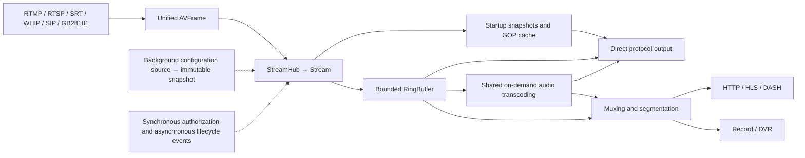
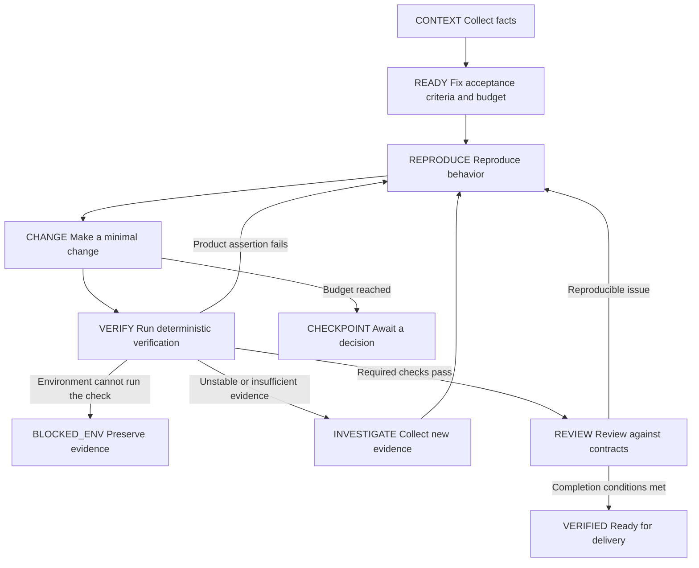

# LiveForge Loop Engineering Development Model

Date: 2026-10-15\
Analysis baseline: `4e70fb3a7b6b3d92bf2e099965f2c81c4f3f98c5`; the workspace was clean when analysis began.\
Status: **Development model design; the first verification executor has been implemented**. `tools/lf-loop` implements bounded verification, JSON evidence, source snapshots, timeout cancellation, and repository mutual exclusion; the actual task format and limitations are defined in the [executor recipe](../../recipes/loop-executor.md). Broader AI repair loops and additional CI orchestration remain later phases, and the current `AGENTS.md` remains in force.

Analysis scope: repository structure and file statistics, with a focus on media ingestion, startup snapshots, overwrite recovery, lifecycle, transcoding, configuration, and verification orchestration. Conclusions apply to the paths inspected; this was not a line-by-line security audit of all source code.

## 1. Objectives and Recommended Approach

This proposal is for developers and AI agents maintaining LiveForge. It defines Loop Engineering as **a development loop that combines objectives, observation, changes, verification, feedback, and knowledge updates so that work can converge, recover, and be audited.** This is a working definition for this project, not a reference to a particular framework.

The unit of delivery for a task is a behavior change verified by evidence. Finished code, a model's declaration of completion, or a command exiting with zero is insufficient on its own to prove completion.

There are three possible organizational approaches:

- **Extend existing CI**: add checks and reports with limited changes. This is suitable for filling gaps in gates first, but does not guide an AI agent in assessing, repairing, and stopping after a failure.
- **An evidence-driven bounded loop, recommended**: people define objectives and permissions; AI makes changes around a single falsifiable hypothesis; deterministic checks produce evidence; failures return to the appropriate step based on their cause. This can directly reuse the current modules, tests, and documentation system.
- **An autonomous agent platform**: build a separate system for scheduling, roles, memory, and automatic delivery. Initial maintenance costs are high, and it cannot resolve missing verification standards by itself. Consider it after the loop is stable.

Success criteria: every requirement is traceable to acceptance conditions and tests; every failure can be classified as a product, environment, or test infrastructure issue; every completion claim is bound to the verified source; recurring problems become reusable regressions. No unmeasured speed or cost improvement targets are set at this stage.

## 2. Code Analysis: Boundaries for Organizing Development

### 2.1 Project Size and Actual Structure

Statistics for Git-tracked Go files at the baseline: 292 non-test files and 276 test files, with 71,573 and 88,817 lines respectively, including blank lines and comments but excluding HTML/JavaScript. `module/` has 15 first-level directories. File and line counts indicate size, not quality, coverage, or complexity scores.

The composition entry point is `cmd/liveforge/main.go`. `core.Module` defines `Name / Init / Hooks / Close`, with optional interfaces for configuration updates and listener address discovery. The main path is:



Key implementation evidence:

- **Core data plane**: `core/stream.go:85` holds publisher generation, cache, subscription, and transcoding state; `WriteFrameForPublisher` validates the current publisher before writing; `StartupSnapshot` atomically captures the generation, headers, replay, and cursors. Organize high-risk changes around invariants rather than assigning work by file.
- **Buffer**: `pkg/util/ringbuffer.go:11` is a single-producer, multiple-consumer structure, but is not entirely lock-free. Slot access is protected by locks, and `TryReadResult` binds the overwrite count to the value read in that operation. The use of atomics does not prove that arbitrary concurrent writes or movement of the same reader are safe.
- **Lifecycle**: `core/event_bus.go:124` provides bounded admission for asynchronous lifecycle events; `enqueueLifecycle` reserves capacity for terminal events. `core/server.go:232` stops alive events, closes modules whose initialization was attempted in reverse order, then drains admitted asynchronous hooks. Development must verify start, failure, stop, repeated close, and resource reclamation.
- **Transcoding**: `core/transcode_manager.go:18` holds the source epoch, generation boundary, and shared target tracks; reader bridges filter history by source position and audio epoch. Transcoding correctness includes history ownership, tail flushing, and release counts; checking codec names alone is insufficient.
- **WebRTC**: `module/webrtc/whep_feed.go` handles startup, pacing, parameter sets, overwrite recovery, reader coordination, and status diagnostics. Existing tests cover source overwrite, target-audio overwrite, and publisher replacement; do not list already fixed problems as features still to implement.
- **Management plane**: `config/runtime/manager.go:16` separates background source I/O from `atomic.Pointer` snapshot reads; `module/api` provides permissions, configuration, and the console. The console embeds HTML and the split `static/*.js` files through `console.go`. The description of a single HTML file in an older plan no longer represents the current structure.
- **Observability and verification**: `module/metrics/collector.go` provides server, configuration, and stream metrics; `tools/testkit/report` already provides structured media results; `pkg/protocoltest/report.go` already provides deterministic protocol check reports. Reuse these results and aggregate them through an adapter layer rather than rewriting the test platform.

### 2.2 Strengths and Engineering Gaps

The existing foundation is substantial: module interfaces, generation isolation, bounded queues, reader ownership, error states, race tests, real browser verification, JSON reports, and an AI documentation contract are all present.

The main engineering gaps identified in this analysis are:

1. **Completion evidence is scattered.** Historical plans, risk records, test output, and benchmark results are spread across multiple locations. The inspected `tools/`, Makefile, and workflows do not yet have a unified Loop task state and evidence protocol.
2. **The stronger gates are not part of a single CI path.** Current CI runs tagged race/coverage tests and requires a browser, H.264, and 15 seconds of matrix progress. `tools/check-review-regressions.sh` separately provides repeated concurrency tests, four categories of fuzzing, and 60 seconds of browser progress by default; current workflows do not invoke it. Ordinary `go test` runs only fuzz seeds and does not replace these timed fuzzing explorations.
3. **Portable builds need independent verification.** The release workflow builds `CGO_ENABLED=0` binaries, while the current CI test job primarily uses `audiocodec`. The fallback behavior under `!audiocodec` cannot be inferred from tagged test results.
4. **Documentation checks cover only part of the semantics.** `tools/check-agent-docs.sh` validates inventories, versions, fixed text, and the rule that source changes must be accompanied by at least one documentation change. It cannot yet prove that an API, configuration, or behavior change has been synchronized to the correct documentation. Explicit impact mappings and corresponding contract tests are still needed.
5. **Historical plans can contaminate context.** The 2026-08-25 Completion Loop plan excluded Simulcast, while current source, tests, and the recipe support fixed layer selection for a session. Historical plans should retain their historical context and must not override current source and verification facts.
6. **Test success still depends on environment semantics.** An unavailable browser, missing H.264, a missing current binary, or incorrect build tags all change the actual verification scope. Record test execution and skips, not just the exit code.

The hotspots in this count are `whep_feed.go` at 1,605 lines, SIP `call_session.go` at 1,468 lines, `core/stream.go` at 1,391 lines, and HTTP `muxer_worker.go` at 1,205 lines. These numbers indicate reading and review costs; they do not directly prove design flaws. Establish cross-module invariants and regressions first, then extract responsibilities within specific tasks. A repository-wide refactor is not recommended.

## 3. Four Layers of the Loop

### 3.1 Intent Loop: From Request to an Assessable Task

The input is a user requirement, reproduction, or confirmed issue. The output is a task card that specifies the scenario, existing behavior, expected behavior, scope, invariants, acceptance method, permitted actions, and budget.

Investigate uncertain requirements within a defined bound; proceed directly to implementation for small fixes with clear behavior. Request a new decision only when changing the objective, an external contract, or an existing authorization boundary. Do not require approval for every test or reversible change.

### 3.2 Change Loop: Verify One Hypothesis at a Time

`Observe → Hypothesize → Minimal behavioral reproduction → Minimal change → Focused verification`

For a behavior fix, first obtain a failing assertion that expresses the problem. A missing compiler, missing dependency, zero test cases, or syntax error does not count as RED evidence of the defect. New features can start with tests expressing unmet behavior; documentation-only changes and low-impact cleanup use the corresponding checks, without adding tests that mirror the implementation merely for formality.

Record the hypothesis, change scope, and verification result for each iteration. If the result disproves the hypothesis, return to observation instead of stacking multiple unverified fixes. For test timing issues, prefer controlled clocks, barriers, and bounded conditional waits; do not suppress the symptom by adding arbitrary sleeps.

### 3.3 Integration Loop: Verify Actual Delivery Conditions

`Focused tests → Package tests → Impact verification → Documentation synchronization → Review → Final snapshot gates`

This checks publisher generations, cross-protocol behavior, build profiles, authorization, browser progress, and resource cleanup. Final verification applies to the same set of source, tests, and documentation; subsequent changes to code or tests invalidate the affected evidence. Start with a conservative rule: any source or test change reruns the final required gates. Introduce verified impact-analysis caching later.

### 3.4 Feedback Loop: Reduce the Cost of the Next Task

`Authorized acceptance or operational feedback → Sanitized reproduction → Regression fixture → Invariant/recipe update → Next task`

Merge, release, and production outcomes are different states. A development task can end when verification passes and the result is ready for delivery; if the task includes a release, separate release and observation evidence is required. Deployment capacity, actual network packet loss, and long-running behavior must be verified separately in the target environment; they cannot be inferred from microbenchmarks or a 60-second correctness matrix.

Retain only stable conclusions from each regression: add a test, correct a rule, add a recipe, or record a verified fact. Store long logs with the evidence; do not append every iteration's reasoning to `llms-full.txt`.

## 4. Seven Groups of Invariants LiveForge Must Preserve

1. **Generation isolation**: frames, callbacks, readers, and releases belonging to an old publisher must not operate on a new generation; streams with the same name must also be distinguished by instance.
2. **Continuity**: after a ring overwrite is detected, the retained frame returned by the overwrite operation must not be sent as if it were continuous media. Each output retains its own policy: continuous HTTP outputs terminate; HLS/LL-HLS can recover within the same generation and mark a discontinuity; DASH preserves completed media and then retires; WHEP recovers according to reader identity.
3. **Audio/video independence**: the source reader and target transcoded-audio reader handle overwrite and EOF separately. Valid video or audio should not be unintentionally interrupted by the other recovery path; EOF on expected target audio in an active generation must not silently degrade playback.
4. **Terminal-state precedence**: cancellation, generation end, abnormal EOF, and normal completion have explicit precedence. Close admission first, then clean up and join; release resources and subscription leases exactly once. Abnormal completion must not perform a normal tail flush.
5. **Bounded resources**: caches, parsers, event queues, configuration documents, history, and metric labels have explicit bounds, with observable outcomes when limits are reached.
6. **Playability**: media success requires actual decoded dimensions, increasing `currentTime`, audio/video RTP and decoded counters, correct status, and no media error. SDP success, `ontrack`, and a page showing Playing are only intermediate signals.
7. **Management consistency**: configuration source I/O stays out of the snapshot-read hot path; failures retain the last valid configuration; desired/effective/restart-required remain distinct; concurrent Apply, authorization, and redaction follow the current contracts.

Invariants are not all proved by one large test. Use deterministic unit tests at the lowest level, real RTP/container checks at protocol boundaries, and browsers for the end-user outcome. Refer to the progress assertions in `test/integration/protocol_browser_matrix_test.go:287`.

## 5. Execution States and Stop Conditions



These states belong to the proposed project task protocol and are unrelated to the built-in states of any particular AI product.

Suggested pilot defaults: verify at most 3 repair hypotheses per task; allocate 30 minutes for changes and investigation, with separate timeouts and execution budgets for long gates. These are adjustable process parameters, not measured durations or product SLOs.

- Once the same source, environment, and failure fingerprint have been confirmed, do not repeat the same fix without new evidence. Rerunning until green is not a closure condition.
- When an environment blocker is found, preserve the current changes and diagnostics. Verification that does not depend on that environment may continue, but required checks cannot be marked as passed.
- For intermittent failures, preserve the first failure, all reruns, and timing evidence. A later success cannot erase the failure. Fix it or establish an evidence-based environment attribution.
- When exiting at the budget limit, leave a checkpoint with the current hypothesis, disproved hypotheses, verified snapshot, remaining risks, and the next recommended action.
- Return to the intent loop when requirements, protocol compatibility, or acceptance thresholds must change, or when an authorization boundary must be crossed. AI must not complete a task by weakening tests, deleting assertions, or changing checks to skips.

## 6. Verification Layers and Change Routing

### L0: Context and Environment

Read the manifest, navigation, and relevant recipes first. Record workspace differences, the Go version, the build profile, and the C toolchain, FFmpeg, Chrome/H.264, and available ports actually required. Define the documentation impact before changing source.

The Xcode license problem actually encountered during this analysis should be classified as `BLOCKED_ENV`; checks without CGO can add evidence, but cannot replace race or transcoding acceptance checks.

### L1: Fastest Behavioral Feedback

Run explicitly named affected tests and confirm that test cases were actually selected. A misspelled `-run` that succeeds with zero cases is a verification failure.

For example, check current WHEP direct audio/video overwrite recovery:

```sh
go test ./module/webrtc -run '^TestWHEPEstablishedDirectMixedSourceOverwriteRecoversAtFreshKeyframe$' -count=1
```

This test already exists; it is a reusable entry point, not evidence that the defect remains.

### L2: Package and Impact Scope

- `core/stream`, ring, EventBus: core/util package and race tests; generation/overwrite/backpressure; compare ingress/reader benchmarks when hot paths are affected.
- WHEP, SIP, GB28181, transcoding: corresponding packages and core; passthrough and tagged transcoding paths; media errors, terminal states, reader cleanup; cross-protocol browser matrix.
- HTTP, Record, DVR: container structure, audio-only streams, long GOPs, abnormal and normal tails, recording permissions, generation draining; tests for build-profile differences.
- API, configuration, Console: permissions and input boundaries, Apply conflicts, desired/effective, draft retention; OpenAPI/schema; corresponding browser tests.
- Parsers/packetizers: lengths and boundaries, truncation/reordering, fuzzing, and the entry-point packages that actually use the parser.
- Metrics/performance: establish correctness and boundedness first, then compare benchmarks on the same machine with the same fixtures and parameters. Do not optimize ns/op at the cost of cancellation or frame-drop semantics.
- Documentation only: links, facts, and Agent documentation checks; this does not require rerunning all media tests.

### L3: Current Full Baseline

The existing project baseline requires a working Go 1.26 installation, C toolchain, and FFmpeg dependencies for the corresponding platform:

```sh
CGO_ENABLED=1 go build -tags audiocodec ./cmd/liveforge
CHROME_BIN='/Applications/Google Chrome.app/Contents/MacOS/Google Chrome' \
LIVEFORGE_REQUIRE_BROWSER=1 LIVEFORGE_PROTOCOL_MATRIX_SOAK=15s \
LF_BINARY="$PWD/liveforge" CGO_ENABLED=1 \
go test -tags audiocodec -race -coverprofile=coverage.out -covermode=atomic ./...
tools/check-agent-docs_test.sh
CHECK_AGENT_DOCS_DIFF=1 tools/check-agent-docs.sh
git diff --check
```

The browser path example is for macOS; Linux CI currently selects `/usr/bin/google-chrome`. For PR documentation-diff checks, explicitly set `BASE_REF` to the actual baseline. The new executor should preserve the project's standard commands and additionally collect `go test -json` events and actual process exit codes; pipelines must preserve failure status.

Maintain a separate verification record for the portable profile: `CGO_ENABLED=0 go test -count=1 ./...` and subprocess tests using the current portable binary. This profile does not provide audio transcoding or run race checks.

### L4: High-Risk Regression and Release Acceptance

Reuse `tools/check-review-regressions.sh`, preserving its repeated concurrency tests, four fuzzing categories, Console checks, and media matrix with a default duration of 60 seconds. First add a separate CI job for relevant high-risk PRs, then decide broader trigger policies based on duration; this orchestration remains to be implemented.

Separate cluster test processes must not run concurrently; the executor needs a serial queue or mutually exclusive resources. Parallelism for other tests depends on whether fixture resources are independent. Do not save time through unconditional repository-wide parallel execution.

Long-running real-network and capacity verification belong to deployment acceptance: record the target environment, workload, input encoding, session count, duration, and thresholds before execution. Do not promise concurrency scale, p95, or availability before measurement.

## 7. Task Card and Evidence Ledger

A task Markdown file and a JSON record for each verification run are sufficient for the first phase. The following is a proposed format, not LiveForge runtime configuration; it must not be placed in `configs/liveforge.yaml`.

```yaml
id: LF-LE-001
kind: verification-orchestration
objective: Integrate the existing WHEP overwrite recovery contract into a reviewable verification loop
scope:
  implementation: tools/ and CI orchestration; specific files to be determined during implementation
  behavior_change: false
invariants:
  - Do not send the retained frame returned by an overwrite operation after source overwrite
  - Preserve the same publisher generation and recover at a new keyframe
  - Target-audio overwrite must not interrupt valid direct video
  - Active target-audio EOF terminates processing and releases the reader exactly once
acceptance:
  - Map every invariant to an existing test that actually executes
  - Record commands, profiles, source digests, case counts, and exit status
  - Report an environment blocker when the C toolchain or browser is missing
  - Incorrect test names, zero cases, or skipped required cases cannot count as a pass
budget:
  hypothesis_limit: 3
  investigation_minutes: 30
  gate_budget: Listed separately, using the timeout of each existing gate
authorization:
  local_reversible_work: Allowed within the current task scope
  external_actions: Determined by the current user authorization; deployment or messaging permission is not implied
```

Minimum evidence fields: `task_id`, `attempt_id`, start/end times, source commit and workspace content digest, command argv, working directory, profile, tool versions, binary and fixture digests, exit code, actual passed/failed/skipped cases, failure classification, log location, documentation impact, and review conclusion.

Workspace digests must cover the final contents of tracked files, staged/unstaged differences, and task-related untracked files. Recording only HEAD cannot represent an uncommitted implementation. Use an allowlist for environment information; do not export all environment variables or write credentials into reports.

Specific rules:

- Store baseline failures, post-fix verification, and post-merge integration verification separately; do not overwrite earlier records.
- Zero skips in JSON events does not mean cases excluded by build tags executed. Use the expected case set together with the profile to verify scope.
- Final completion is determined jointly by gate results, scenario acceptance, documentation impact, and review; a model's completion statement is only an explanation.
- A future runner should use a deterministic `check → classify → report` core, involving AI only when hypotheses and changes are needed. Do not start by building a complex agent scheduling platform.
- Current `lf-test` JSON and protocol self-test Reports enter the ledger through an adapter layer. Browser evidence must still come from actual decoding tests and cannot be replaced by server packet counts.

## 8. Definition of Done, Roles, and Knowledge Maintenance

A development task enters VERIFIED only when all of the following hold: there is evidence for the target behavior; applicable invariants hold; required profiles and cases actually executed; final snapshot checks pass; documentation is accurately synchronized; there are no unexplained relevant failures; and every remaining item has a stated scope and owner.

Roles describe responsibilities and do not require multiple agents:

- **Objective owner**: decides acceptance conditions, priorities, budgets, and externally visible behavior.
- **Implementer**: locates the issue, builds a minimal reproduction, makes changes, and records hypotheses.
- **Verifier and reviewer**: uses test results and source to check counterexamples, boundaries, and documentation; high-risk changes may warrant another developer or an independent review session.
- **Executor**: preserves snapshots and logs, serializes shared resources, and evaluates completion conditions; it has no authority to change acceptance criteria itself.

Knowledge is separated by purpose: `AGENTS.md` holds rules, the manifest holds structured facts, `llms.txt` provides navigation, `llms-full.txt` describes current behavior, recipes describe workflows, historical specs/plans retain their original context, and tests preserve executable lessons. Historical verification conclusions do not automatically become current verification.

First measure ten real tasks: median and p95 time from READY to VERIFIED, repair iterations per successful task, first-attempt gate pass rate, time blocked by the environment, recurring regression rate, and actual tokens/cost when tools provide them. Assess completion rate, speed, and cost together; do not treat changed line counts or model output volume as productivity.

## 9. Phased Implementation

1. **Pilot the task protocol**: adopt task cards and evidence records, starting with the WHEP gate orchestration task above. Acceptance means reusing existing cases, identifying environment blockers, and rejecting zero cases; do not add duplicate business-logic tests.
2. **Consolidate execution entry points**: introduce a thin orchestration layer under `tools/` that supports profiles, timeouts, JSON events, final snapshots, and cluster mutual exclusion. Add tests for the orchestrator itself covering exit codes, zero cases, skips, timeouts, signal cleanup, and evidence invalidation.
3. **Complete the CI loop**: integrate the portable profile and high-risk regression gate, archive reports, and configure required checks; preserve the existing Node 24-compatible action major versions. Adjust trigger scope after adding duration observations.
4. **Improve fact synchronization**: implement hints mapping changed paths to documentation types, together with corresponding API/schema contract checks. Cover error-prone API, configuration, and build capabilities first; do not claim static scanning can fully understand documentation semantics.
5. **Introduce feedback learning**: turn real regressions into sanitized fixtures and tasks. After collecting data from ten tasks, decide whether autonomous scheduling, scheduled capacity tasks, or independent agent review would be worthwhile.

Phases 1–2 have been implemented by the first `lf-loop` verification executor. Subsequent CI work, semantic documentation mappings, and autonomous scheduling should continue in the order above. No background loop or scheduled task has been created.

## 10. Analysis-Phase Verification and Subsequent Implementation

The analysis phase actually ran ordinary package checks, full package checks without CGO, a portable build, and documentation checks. Ordinary `go test ./...` encountered a `runtime/cgo` error because the Xcode license had not been accepted on this machine. Go was 1.26.0 on darwin/arm64; FFmpeg files and pkg-config information were present, but that did not establish a working C toolchain.

`CGO_ENABLED=0 go test -json -count=1 ./...`: 54 packages passed, with 2,824 tests/subtests passed and 1 skipped. The skipped case was `TestClusterOriginEdge`, which lacked a current binary. A current portable binary was then built with `CGO_ENABLED=0 go build -o /tmp/liveforge-loop-liveforge ./cmd/liveforge`, and the separate supplementary check `CGO_ENABLED=0 LF_BINARY=/tmp/liveforge-loop-liveforge go test -json ./tools/testkit/cluster -run '^TestClusterOriginEdge$' -count=1` passed in 7.04 seconds. Results from the two runs were preserved separately; the first skip was not rewritten as a pass. The tagged/race full baseline and tagged browser matrix were not completed in this analysis because of the C toolchain limitation; historical coverage is not cited as a result of this run.

These figures belong to the analysis phase before the executor implementation and do not represent verification of the new source. The user subsequently authorized the first executor implementation; `internal/loopexec`, `tools/lf-loop`, and task examples have now been added, with the manifest, llms documentation, English and Chinese READMEs, `AGENTS.md`, and [executor recipe](../../recipes/loop-executor.md) synchronized. Server runtime configuration, the REST API, and the configuration schema are unchanged. See the [implementation record](../plans/2026-10-15-loop-executor.md) for implementation-phase verification results and known environment blockers.

## 11. Verification References

- [Current Agent contract](../../../AGENTS.md)
- [Structured facts](../../../agent-manifest.json)
- [Full project context](../../../llms-full.txt)
- [Module interface](../../../core/module.go)
- [Stream and startup snapshots](../../../core/stream.go)
- [RingBuffer and atomic overwrite results](../../../pkg/util/ringbuffer.go)
- [EventBus](../../../core/event_bus.go)
- [WHEP data path](../../../module/webrtc/whep_feed.go)
- [WHEP direct-source overwrite tests](../../../module/webrtc/whep_feed_overwrite_test.go)
- [WHEP transcoding overwrite tests](../../../module/webrtc/whep_feed_overwrite_audiocodec_test.go)
- [Cross-protocol real-browser matrix](../../../test/integration/protocol_browser_matrix_test.go)
- [CI](../../../.github/workflows/ci.yml)
- [Regression gates and environment notes](../../recipes/review-regression-gate.md)
- [Historical Completion Loop plan](../plans/2026-08-25-liveforge-completion-loop.md)
- [Technical risks and historical verification](../../TECHNICAL-RISKS.md)
